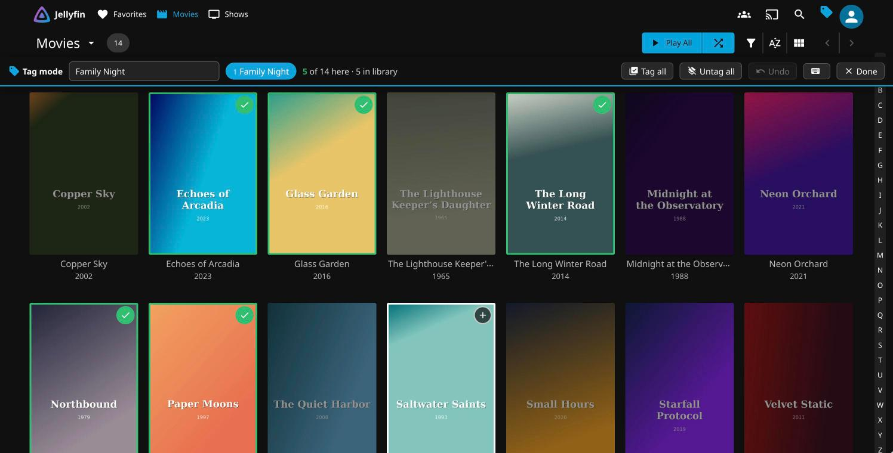
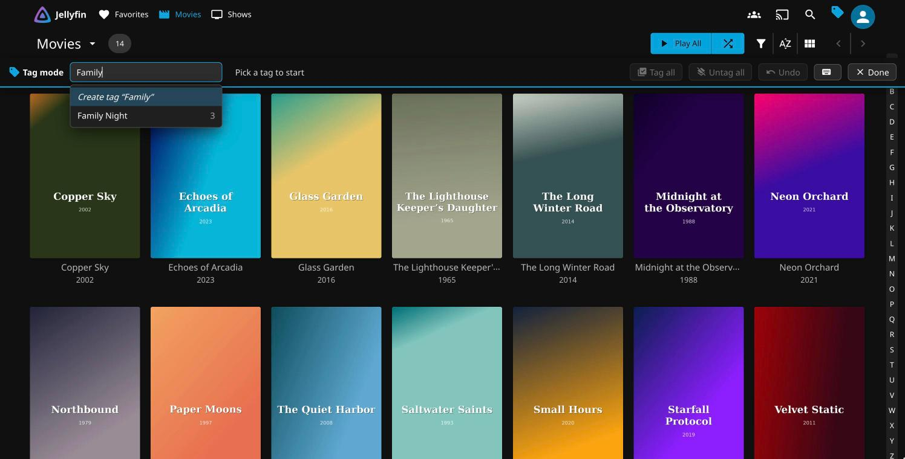
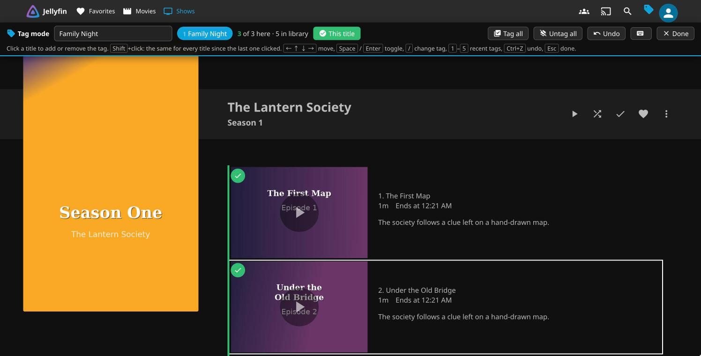

# QuickTag for Jellyfin

Bulk tag editing from the Jellyfin web client. Turn on **Tag mode**, pick a tag (or type a new
one), then click titles to add or remove it: no metadata editor, no leaving the page.



- Works on any page that shows movies or shows: library grids and lists, home rows, search,
  collections, a show's seasons and episodes.
- Click a title to toggle the tag. Tagged titles get a green border and check; the rest are dimmed.
- **Shift+click** applies the same change to every title between the last one clicked and this one.
- **Tag all / Untag all** for everything on the page (click twice to confirm).
- On a details page, **This title** toggles the tag on the title itself.
- Tagging a show or season also tags its seasons and episodes, as the metadata editor does
  (children whose tags are locked are skipped).
- **Undo** (Ctrl/Cmd+Z), up to 50 steps.
- The last five tags are one click (or key **1**–**5**) away.

| Pick or create a tag | Tag a whole season from its page |
| --- | --- |
|  |  |

Keyboard, while Tag mode is on:

| Key | Does |
| --- | --- |
| ← ↑ ↓ → | move between titles |
| Space / Enter | toggle the tag on the highlighted title (Shift: range) |
| `/` or `t` | change tag |
| 1–5 | switch to a recent tag |
| Ctrl/Cmd+Z | undo |
| Esc | leave Tag mode |

Only administrators see the Tag mode button; the API requires an administrator too.

## Requirements

- Jellyfin **12.4** (built against 12.4.0, .NET 10).
- The **File Transformation** plugin, which lets plugins add scripts to the web client without
  touching its files. Add the repository
  `https://www.iamparadox.dev/jellyfin/plugins/manifest.json` (Dashboard → Plugins →
  Repositories), install *File Transformation*, restart.

  Without it, QuickTag tries to add its script to `jellyfin-web/index.html` directly. That only
  works where the web folder is writable, which it isn't in the official container image run as
  a non-root user.

## Install

Each release has a Jellyfin plugin repository file that offers just that release. In
**Dashboard → Plugins → Repositories**, add

```
https://github.com/mikebean233/jellyfin-quicktag-plugin/releases/download/v1.0.2/manifest.json
```

(swap the tag to pin another version, or use `releases/latest/download/manifest.json` to
follow new releases), then install **QuickTag** from the catalog and restart Jellyfin.

The same works for File Transformation with
`https://github.com/mikebean233/jellyfin-plugin-file-transformation/releases/download/v3.0.3.2/manifest.json`,
a fork without HTTP endpoint callbacks. Don't add upstream's repository as well.

To install by hand instead, unzip a release's `quicktag_<version>.zip` into
`<config>/plugins/QuickTag/` and restart.

## Build

```bash
dotnet build -c Release
# Jellyfin.Plugin.QuickTag/bin/Release/net10.0/Jellyfin.Plugin.QuickTag.dll
```

Pushing a `vX.Y.Z` tag builds the plugin and attaches the zip and its `manifest.json` to a GitHub release.

## How it works

| Piece | File |
| --- | --- |
| Web client script (the Tag mode bar, card badges, clicks, keys) | `Web/quicktag.js`, embedded in the DLL |
| Serves the script at `/QuickTag/ClientScript` | `Api/QuickTagController.cs` |
| Adds `<script src="../QuickTag/ClientScript">` to `index.html` at startup: via File Transformation, else on disk | `Injection/ScriptInjector.cs`, `IndexHtmlPatcher.cs` |
| Reads and writes tags | `Api/TagService.cs` |

API (administrators only):

- `GET /QuickTag/Tags`: every tag on a movie, show, collection or video, with counts.
- `GET /QuickTag/Items?tag=<tag>`: ids of the items (including seasons and episodes) with the tag.
- `POST /QuickTag/Apply` `{"Tag": "...", "Add": [ids], "Remove": [ids]}`: saves through the
  same path as the metadata editor (`UpdateToRepositoryAsync(MetadataEdit)`, which also runs NFO
  savers if they are on).

Tags can't contain `|` (the database stores an item's tags in one `|`-separated column).

The script finds titles by the `data-id`/`data-type` attributes jellyfin-web puts on its cards
and list rows, and adds its button to whichever header is showing (the React app bar on library
pages, the classic header elsewhere). A jellyfin-web update that changes those could need a
script update.
